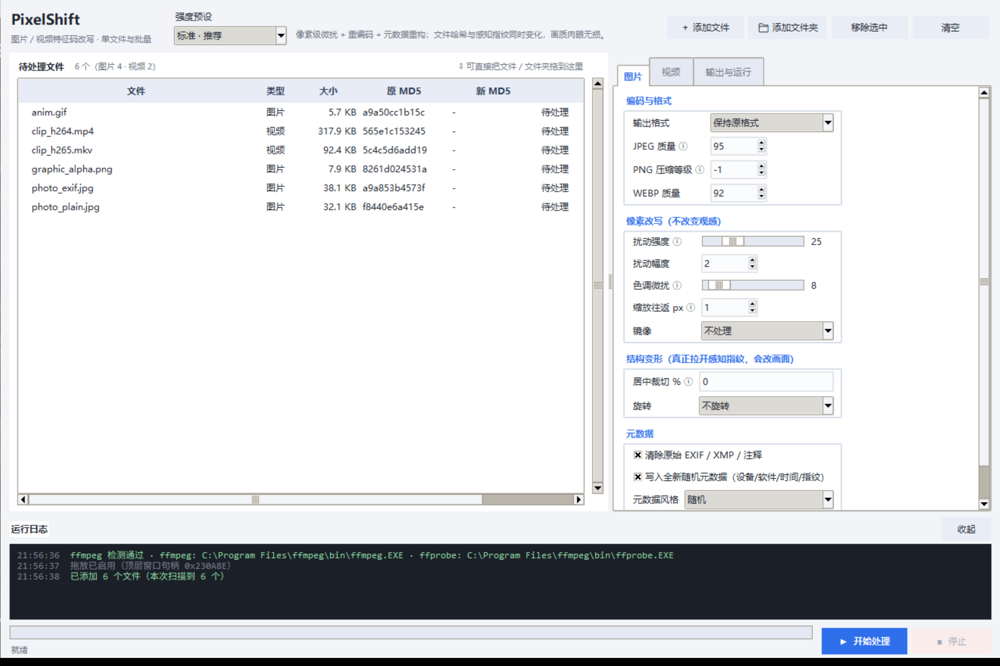
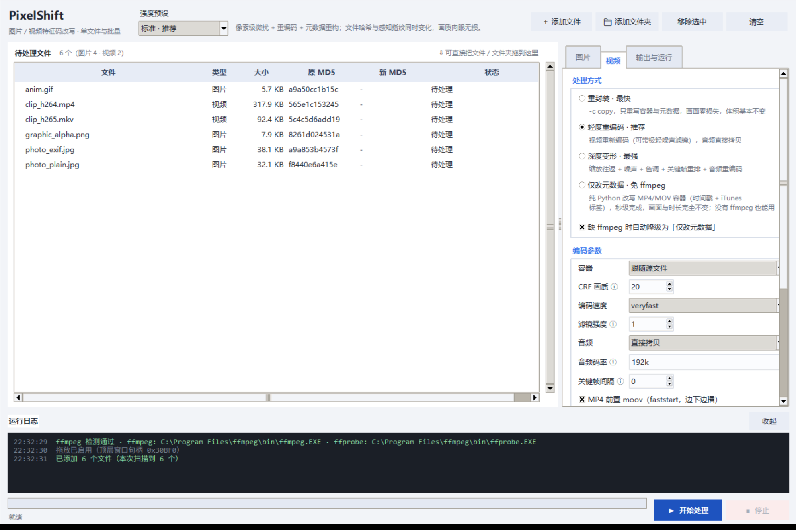
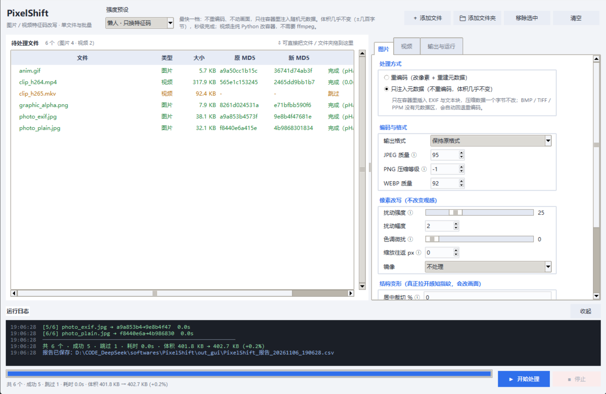

# PixelShift

**English** | [简体中文](README.md)


Batch-rewrite the **fingerprint** of images and videos: file hashes always change, perceptual
hashes change as much as you want, metadata gets rebuilt from scratch. Everything runs locally —
no network calls, nothing uploaded.



## Download

Get the **[latest release](https://github.com/kandsome1/PixelShift/releases/latest)**:

| File | Download | Unpacked | Notes |
|---|---|---|---|
| `PixelShift-1.4.4-win64.exe` | 11.7 MB | — | **Recommended.** Single file, double-click to run, no Python needed |
| `PixelShift-1.4.4-win64-onedir.zip` | 11.7 MB | 25.9 MB | Unzip and run `PixelShift.exe`. Faster startup (1.3s vs 2.5s), fewer AV false positives |

> Both downloads are roughly the same size because the 994 files inside the onedir build compress
> to about 45%. The real differences are disk footprint after extraction and startup time.

The `Source code` archives at the bottom of the release page are for developers.

**First launch:** Windows SmartScreen will warn you (the binary is not code-signed).
Click **More info → Run anyway**.

## Quick start

1. **Add files** — click *Add files / Add folder*, or just **drag files into the window**.
   Folders are scanned recursively, and the original MD5 appears immediately for each file.
2. **Pick a preset** — default is *Lazy*; step up only if you also need the visual fingerprint to change.
3. **Start** — leave the output folder empty to write next to each source file in `_pixelshift`.

When it finishes, the list is filled with the new MD5 and perceptual-hash delta, and a CSV report
lands in the output folder.

To process a single file: **File → Quick process single file…**

## Presets

| Preset | What it does | Size change | Speed |
|---|---|---|---|
| **Lazy** (default) | Injects random metadata only — no re-encode, not a single pixel touched | **+0.2%** | instant |
| **Light** | Re-encodes and rebuilds metadata, negligible visual change | ±0% | seconds |
| **Standard** | Pixel-level perturbation + slight color shift + re-encode | ~+30% | seconds |
| **Strong** | 1.5% center crop + grain + color shift + deep re-encode | +50–150% | slower |

Lazy is the default: it changes the file hash and nothing else. Step up only when the
*visual* fingerprint needs to differ too.

> 16-bit grayscale, CMYK print files and 10-bit HDR video automatically fall back to a
> metadata-only path — no operation that would lose bit depth or color space is applied.

## What it actually changes

A file has three identities, and the tool can touch each separately.

**① File hash (MD5 / SHA1)** — always changes. The old and new hashes are shown side by side
in the list and the report.

**② Perceptual hash (pHash)** — kicks in from *Standard* upward: pixel perturbation,
resize round-trip, subtle color drift. For a bigger delta, enable **center crop** (crop 1.5–3%
then scale back), mirroring, rotation, or video grain and speed change. Each image gets a
`pHashΔ` value; a Hamming distance of 15+ out of 64 counts as a clearly different frame.

**③ Metadata** — original EXIF / container metadata can be wiped and replaced with a fresh
random set: camera make and model, software name, capture time, artist, a 16-character
fingerprint string. On video, `comment`, `title`, `handler_name` and `creation_time` are rewritten.

## Use cases

| Scenario | How |
|---|---|
| **Strip privacy before sharing photos** | Enable *Clear original EXIF / XMP / comments* with the **Lazy** preset. GPS coordinates, device serial numbers, capture time and software traces are wiped and replaced with random values; not a pixel changes |
| **Organize a media library** | Run the **Lazy** preset in bulk — files no longer collide or get auto-merged by hash |
| **Generate test fixtures** | Need N files with identical content but different hashes? Run the same image N times — every run injects different metadata |
| **Normalize metadata before archiving** | Photos from mixed devices get a clean, consistent set of fields, so sorting by capture time works |
| **De-identify before redistribution** | `creation_time`, `encoder` and device handler names leak capture device and time; replace them with the metadata-only mode. Picture and duration stay identical |
| **Size-constrained destinations** | Lazy preset on a 400 KB batch: 400 KB → 402 KB (+0.2%) |
| **Need every copy to be unique** | Use **Light**: each file is re-encoded and given fresh metadata, visually lossless and all hashes differ |

Scope note: this tool deals with **hashes and metadata** only. It is not a content editor —
cropping the composition, removing watermarks, concatenating clips or editing text are out of scope.

## Interface

<table>
<tr>
<td width="50%"></td>
<td width="50%"></td>
</tr>
<tr>
<td align="center">Video has four processing modes, including an ffmpeg-free metadata mode</td>
<td align="center">Each row reports the new MD5, hash delta and elapsed time</td>
</tr>
</table>

Three tabs on the right:

- **Images** — processing mode (re-encode / metadata only), output format, quality, pixel
  perturbation, structural transforms, metadata
- **Video** — processing mode (remux / light re-encode / deep transform / metadata only),
  encoder settings, mirror/crop/speed, metadata
- **Output & run** — output folder, collision policy, concurrency, open-folder-on-finish

Anything marked ⓘ has a tooltip.

## FAQ

**Do I need ffmpeg?**
No. Image processing and the metadata-only mode for MP4/MOV work without it. The app looks for
ffmpeg in `PATH` and common install locations; if it is missing, MP4/MOV fall back to metadata
mode, and only MKV / AVI / WEBM (which need re-encoding) get skipped with a notice.

**Why did the video get bigger?**
*Standard* adds subtle grain; the encoder spends more bitrate preserving it, so ~30% growth is
expected. To keep size down: raise CRF to 22–26, drop filter strength to 0–1, or use Lazy / Light.

**pHashΔ is 0 or very small?**
Flat colors, text screenshots and simple geometry are inherently insensitive to tiny changes —
that is how pHash is designed. Enable *Structural transforms → center crop* with 1.5–3 for a
real difference.

**Will my originals be overwritten?**
By default no — output goes to a separate folder. Only when the output folder is the source
folder *and* collision policy is set to *overwrite* does it replace in place, and even then it
writes to a temp file and swaps atomically, so an interruption never leaves a half-written file.

**Supported formats**
Images: `jpg` `jpeg` `png` `webp` `bmp` `tif` `tiff` `gif` (incl. animated) `ppm`
Video: `mp4` `m4v` `mov` `mkv` `avi` `flv` `wmv` `webm` `ts` `mpg` `mpeg` `m2ts` `3gp` `rmvb`
(MKV / AVI / WEBM need ffmpeg; MP4 / MOV / 3GP / M4A work in metadata mode without it)

**Antivirus flags the exe / deletes it?**
PyInstaller binaries are a common heuristic false positive. The `onedir.zip` build usually
avoids it — it is a plain directory with no runtime extraction. If it still triggers, add an
exclusion.

**Can it handle thousands of files?**
Yes, but the list computes an MD5 per file, so several thousand files will be slow to load.
Process in batches, or drag a folder and let it scan recursively.

## License

MIT — see [LICENSE](LICENSE). Keep the copyright notice when redistributing.

---

<details>
<summary>Command line usage (optional, for scripting)</summary>

```bat
:: Strong preset on a whole folder
python app.py -i D:\media -o D:\out -p strong

:: Lazy: change hashes only, leave the picture untouched
python app.py -i D:\media -o D:\out -p lazy

:: Images only, append a random suffix to filenames
python app.py -i D:\media -o D:\out --only image --random-name

:: Process video without ffmpeg (falls back to metadata mode)
python app.py -i D:\media -o D:\out --video-mode metabox

:: Dry run — list what would be processed
python app.py -i D:\media --dry-run
```

| Flag | Description |
|---|---|
| `-i` / `--input` | Files or folders, can be repeated |
| `-o` / `--out` | Output folder; empty writes to `_pixelshift` next to sources |
| `-p` / `--preset` | `lazy` / `light` / `medium` / `strong` |
| `--only` | `all` / `image` / `video` |
| `--video-mode` | `remux` / `light` / `deep` / `metabox` |
| `--no-fallback` | Do not fall back when ffmpeg is missing |
| `--concurrency` | Image worker threads (default 4) |
| `--video-workers` | Concurrent ffmpeg processes (default 2) |
| `--overwrite` | Overwrite instead of renaming on collision |
| `--random-name` | Append a 4-character random suffix |
| `--seed` | Fixed seed for reproducible output |
| `--dry-run` | List files without processing |

Running from source needs Python 3.9+ and `pip install -r requirements.txt`.

</details>
