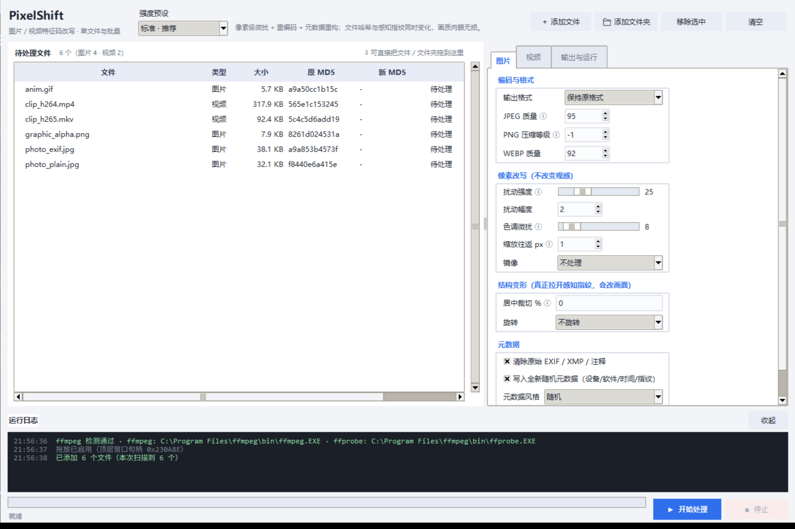
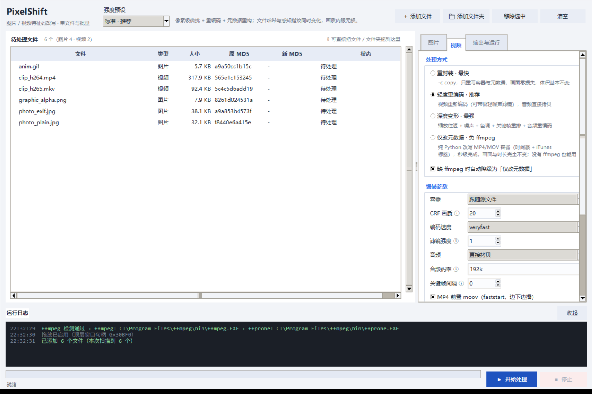
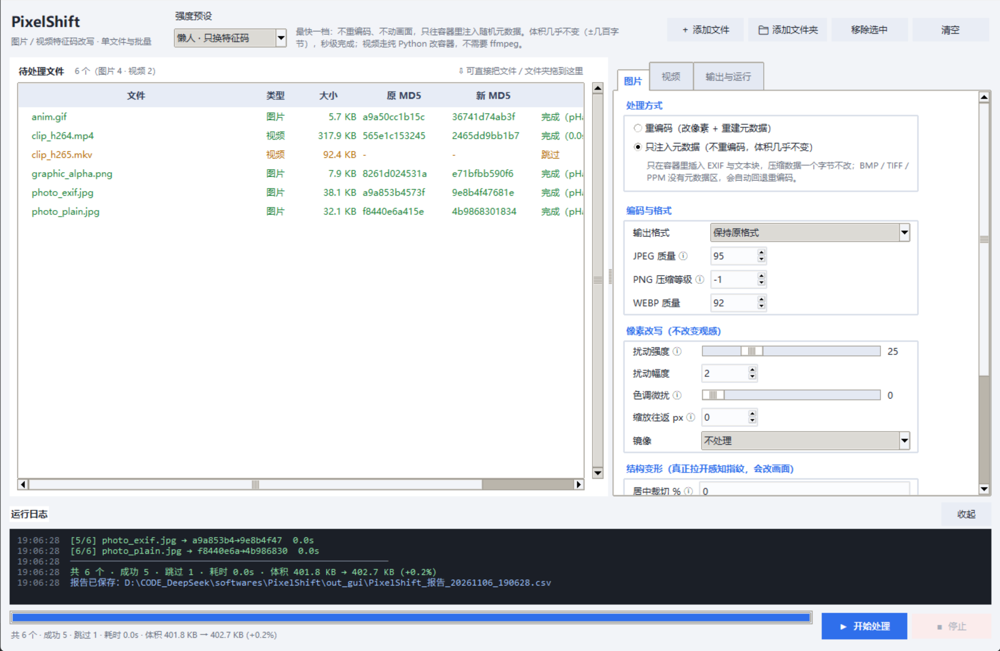

# PixelShift


批量或单个改写图片、视频的**特征码**：文件哈希必变，画面指纹按强度可选，元数据可清空重建。
全程本地运行，不联网、不上传任何文件。



## 下载

前往 **[最新版本](https://github.com/kandsome1/PixelShift/releases/latest)** 下载：

| 文件 | 下载 | 解压后 | 说明 |
|---|---|---|---|
| `PixelShift-1.4.3-win64.exe` | 11.7 MB | — | **推荐**。单文件，双击即用，不用装 Python |
| `PixelShift-1.4.3-win64-onedir.zip` | 11.7 MB | 25.9 MB | 解压后双击 `PixelShift.exe`。启动更快（1.3s vs 2.5s），杀软误报更少 |

> 两个下载大小几乎一样（11.7 MB），是因为 onedir 里 994 个文件压缩率很高（约 45%）。
> 区别在于**解压后的磁盘占用**（25.9 MB）和**启动速度**。

页面底部的 `Source code` 是源码包，普通使用不用下。

**第一次运行时** Windows 会弹 SmartScreen 拦截（"Windows 已保护你的电脑"），点
**更多信息 → 仍要运行** 即可。程序未做代码签名，这一步是正常的。

## 三步上手

1. **加文件** — 点「添加文件 / 添加文件夹」，或者直接把文件、文件夹**拖进窗口**。
   文件夹会递归扫描子目录，列表立刻显示每个文件的原始 MD5。
2. **选强度** — 顶部下拉框选一档（懒人 / 轻度 / 标准 / 强力），右侧面板可以再逐项微调。
3. **开始处理** — 输出目录留空就写到源文件旁边的 `_pixelshift` 文件夹。
   处理完列表里会回填新 MD5 和画面指纹差异，输出目录还会生成一份 CSV 报告。

只想处理一个文件：菜单 **文件 → 快速处理单个文件…**，选完直接开跑。

## 四档强度怎么选

| 预设 | 改了什么 | 体积变化 | 速度 | 适合 |
|---|---|---|---|---|
| **懒人**（默认） | 只往容器里注入随机元数据，不重编码、不动一个像素 | **+0.2%** | 瞬时 | 只想换掉文件哈希，要求体积几乎不变 |
| **轻度** | 重新编码 + 重建元数据，像素几乎不动 | ±0% | 秒级 | 想换字节又完全保留画质 |
| **标准** | 像素微扰 + 轻微调色 + 重编码 | +30% 左右 | 秒级 | 需要画面指纹也有变化，肉眼看不出差别 |
| **强力** | 裁切 1.5% + 加噪 + 调色 + 视频深度重编码 | +50%~150% | 较慢 | 需要连"画面指纹"一起拉开差距 |

默认就是**懒人**：只换文件哈希，不动画面，体积不变。需要连画面指纹一起改时，再往上调。

> 16bit 灰度图、CMYK 印刷稿、10bit HDR 视频会自动进入「只改元数据」的保守路径，
> 不做任何会损失精度或色彩空间的像素操作。

## 它到底改了什么

一个文件有三层"身份"，这个工具能分别动它们：

**① 文件特征码（MD5 / SHA1）**
任何一档强度下都**必然改变**。列表和报告里会给出新旧 MD5 对照，能不能变一眼可见。

**② 画面指纹（pHash / 平台查重用的感知哈希）**
从"标准"档开始介入：像素微扰、缩放往返、色调漂移。想要差距更大，可以打开
「结构变形」里的**居中裁切**（裁掉 1.5%~3% 再放大回原尺寸）、镜像、旋转，
或给视频加噪声、变速。工具会为每张图片算出处理前后的 pHash 差异（`pHashΔ`），
64 位里差 15 位以上就算明显不同的画面了。

**③ 元数据**
可以清空原始的 EXIF / 容器元数据，再写入一整套全新的随机信息：相机品牌型号、
软件名、拍摄时间、作者、16 位指纹串。视频侧会重写 comment、title、handler_name
和 creation_time。

## 典型用途

| 场景 | 怎么做 |
|---|---|
| **发照片前清掉隐私** | 图片页勾「清除原始 EXIF / XMP / 注释」，用**懒人**档。GPS 坐标、设备型号序列号、拍摄时间、软件痕迹会被清空并换成随机值，画面一个像素不动 |
| **素材库整理，避免互相覆盖** | **懒人**档批量跑一遍，体积只涨 0.2%。同源素材的多份副本在库里不再冲突，也不会被按哈希自动合并 |
| **给自己造测试样本** | 需要一批"内容一致、哈希不同"的文件时，同一张图连跑 N 次——每次注入的元数据都不同，得到 N 个互不相同的文件 |
| **归档前统一元数据** | 不同设备拍的照片混在一起时，用**懒人**档统一成一套干净字段，按拍摄时间排序不会乱 |
| **二次分发前脱敏** | 视频里的 `creation_time`、`encoder`、设备句柄名会暴露拍摄设备和时间，用**仅改元数据**模式统一替换，画面与时长不变 |
| **体积不能变大** | 网盘或邮箱有体积限制时用**懒人**档：整批 400 KB → 402 KB，增长 0.2% |
| **批量素材要互不相同** | 用**轻度**档，每份都重新编码 + 重建元数据，画质基本无损而哈希各不相同 |

边界：它只管文件的**特征码与元数据**，不做内容级编辑——裁画面内容、去水印、拼接、修改文案这些不归它管。

## 界面速览

<table>
<tr>
<td width="50%"></td>
<td width="50%"></td>
</tr>
<tr>
<td align="center">视频分四档处理方式，含免 ffmpeg 的元数据模式</td>
<td align="center">每行回填新 MD5、指纹差异与耗时，绿色即成功</td>
</tr>
</table>

右侧三个页签：

- **图片** — 处理方式（重编码 / 只注入元数据）、输出格式、画质、像素扰动、结构变形、元数据
- **视频** — 处理方式（重封容 / 轻度重编码 / 深度变形 / 仅改元数据）、编码参数、镜像裁切变速、元数据
- **输出与运行** — 输出目录、同名冲突策略、并发数、完成后打开目录

所有选项后面带 ⓘ 的，鼠标悬停有说明。

## 常见问题

**需要装 ffmpeg 吗？**
不装也能用。图片处理、以及 MP4/MOV 的「仅改元数据」模式都完全不需要它。
程序会自己在 `PATH` 和常见安装位置找 ffmpeg；找不到时，MP4/MOV 会自动降级成
元数据模式，只有 MKV / AVI / WEBM 这类需要重编码的格式会提示跳过。

**处理完视频变大了？**
「标准」模式会加轻微噪声，编码器要多花码率去保留这些细节，体积涨 30% 左右是正常的。
想压住体积：把「CRF 画质」调高到 22~26，或者把「滤镜强度」降到 0~1，
或者直接改用「懒人 / 轻度」。

**pHashΔ 显示 0 或者很小？**
纯色块、文字截图、简单几何图案这类画面，感知哈希天生对微小改动不敏感——这正是它的设计。
要拉开差距就打开「结构变形 → 居中裁切」，填 1.5~3。

**原文件会被覆盖吗？**
默认不会。输出写到别的目录，源文件原样保留。只有当「输出目录」设成源文件所在目录
并且「同名文件」选了「覆盖」时才会原地替换——这种情况下程序也是先写临时文件再原子替换，
中途断电或强退都不会留下半个损坏的文件。

**支持哪些格式？**
图片：`jpg` `jpeg` `png` `webp` `bmp` `tif` `tiff` `gif`（含动画）`ppm`
视频：`mp4` `m4v` `mov` `mkv` `avi` `flv` `wmv` `webm` `ts` `mpg` `mpeg` `m2ts` `3gp` `rmvb`
（MKV / AVI / WEBM 等需要 ffmpeg；MP4 / MOV / 3GP / M4A 无 ffmpeg 时可用元数据模式）

**杀软报毒 / 文件被删？**
PyInstaller 打出来的 exe 常被启发式误报。换用 `onedir.zip` 版本通常就没问题，
它是普通目录结构，不涉及运行时解压。如果仍然误报，可以加入信任列表。

**能批量处理几千个文件吗？**
可以，但列表要逐个算 MD5，几千个文件时会有点慢。建议分批，或者直接拖文件夹让它递归扫描。

## 许可

MIT License —— 见 [LICENSE](LICENSE)。自行分发时请保留版权声明。

---

<details>
<summary>命令行用法（可选，适合脚本批处理）</summary>

```bat
:: 用「强力」处理整个目录
python app.py -i D:\素材 -o D:\输出 -p strong

:: 懒人模式：只换特征码，不动画面
python app.py -i D:\素材 -o D:\输出 -p lazy

:: 只处理图片，文件名加随机后缀
python app.py -i D:\素材 -o D:\输出 --only image --random-name

:: 缺 ffmpeg 时也要处理视频（自动降级为元数据模式）
python app.py -i D:\素材 -o D:\输出 --video-mode metabox

:: 先看看会处理哪些文件，不实际执行
python app.py -i D:\素材 --dry-run
```

| 参数 | 说明 |
|---|---|
| `-i` / `--input` | 文件或目录，可给多个 |
| `-o` / `--out` | 输出目录；留空则写到源目录旁 `_pixelshift` |
| `-p` / `--preset` | `lazy` / `light` / `medium` / `strong` |
| `--only` | `all` / `image` / `video` |
| `--video-mode` | `remux` / `light` / `deep` / `metabox` |
| `--no-fallback` | 缺 ffmpeg 时不自动降级 |
| `--concurrency` | 图片并发线程（默认 4） |
| `--video-workers` | 同时跑的 ffmpeg 数量（默认 2） |
| `--overwrite` | 同名覆盖而不是改名 |
| `--random-name` | 文件名追加 4 位随机后缀 |
| `--seed` | 固定随机种子，结果可复现 |
| `--dry-run` | 只列文件不执行 |

直接运行源码需要 Python 3.9+ 和 `pip install -r requirements.txt`。

</details>
